# SMA-Finger-Control

This repository contains software for an externally actuated robotic finger system and the measurement pipeline around it. It combines:

- actuator and servo control code for real hardware
- camera-based observation and offline video processing
- post-processing scripts for tendon excursion and moment arm estimation
- small GUI and utility layers for operating experiments

The repo is not just analysis code. Some entry points can move physical hardware or open live cameras. Anyone reading or modifying this repo should treat it as a robot-facing codebase first and a data-processing repo second.

## What This Repo Is For

The overall goal is to run experiments on a finger-like robotic setup, record what happened, and derive relationships between joint motion and tendon excursion.

In practice, the codebase supports workflows like:

1. driving actuators or servos that affect the finger mechanism
2. recording synchronized dual-camera sessions
3. estimating finger joint angles from one camera using DeepLabCut keypoints
4. estimating tendon or weight displacement from the other camera using ArUco markers
5. saving a processed CSV that combines joint angles and displacement signals
6. fitting tendon excursion and moment arm curves from those processed CSVs
7. using saved moment arm coefficients to predict excursion or infer joint motion

## Safety And Operational Context

This repo interfaces with external hardware. That includes servo hardware, PCA9685/FTDI-based actuation, and live cameras.

Important implications:

- Do not assume scripts are safe to run on an arbitrary machine.
- Do not run control scripts unless you understand what hardware is connected.
- Prefer mock or offline paths when exploring the repo.
- Review configuration files before executing anything that opens serial ports, FTDI devices, or cameras.
- Keep an emergency stop path available when working with real actuators.

Concrete examples from the code:

- [src/controller/interface.py](src/controller/interface.py) can build a real actuator backend over FTDI unless `--mock` is used.
- [src/controller/servo/command_sender.py](src/controller/servo/command_sender.py) handles project-level servo commands through ServoHardwareAPI.
- [src/controller/servo/force_control/gui](src/controller/servo/force_control/gui) provides the six-servo force-control GUI.
- [src/controller/csv_player](src/controller/csv_player) provides the CSV trajectory playback GUI.
- [src/observation/vision/record_dual_cameras.py](src/observation/vision/record_dual_cameras.py) opens two live cameras and records experiment sessions.

If you are an agent or a new collaborator, default to reading, plotting, and mock/offline code paths unless the user explicitly wants hardware interaction.

## Launching The GUIs

From the repository root, use `cmd.exe` and the `FingerControl` environment:

```cmd
call "C:\Users\ynaga\anaconda3\condabin\conda.bat" activate FingerControl
set "PYTHONPATH=%CD%\src"
python -m controller.servo.force_control.gui
```

To launch the CSV Player GUI, replace the last line with:

```cmd
python -m controller.csv_player
```

Both GUIs can operate real hardware. Confirm the target configuration and emergency-stop path before connecting to a live system.

## High-Level Architecture

### 1. Hardware Control

There are two distinct control areas in the repo.

- `src/controller`
  - higher-level actuator interface for duty-ratio based control
  - includes a mock backend and a limiter/watchdog layer
  - likely used for SMA or related external actuation hardware through FTDI/PCA9685
- `src/controller/servo`
  - servo-specific tooling, firmware, serial API, and GUIs
  - includes direct PC-to-servo commands and a newer GUI/API stack

This split means "control" in this repo does not refer to one single hardware path. Some experiments appear to use a PCA9685/FTDI duty interface, while others use serial servos.

### 2. Observation And Recording

`src/observation` contains the camera and vision stack.

- `src/observation/camera`
  - camera setup, calibration, preview, and recording helpers
- `src/observation/vision`
  - experiment-specific vision pipelines
  - DeepLabCut-based joint angle estimation
  - ArUco-based displacement measurement
  - dual-camera session processing

The core dual-camera workflow is:

1. record a session with [src/observation/vision/record_dual_cameras.py](src/observation/vision/record_dual_cameras.py)
2. process the saved videos with [src/observation/vision/process_dual_recording.py](src/observation/vision/process_dual_recording.py)
3. obtain a CSV with joint angles and `weight_*_disp_mm` measurements

### 3. Data Processing And Identification

`src/dataProcessing` holds the offline scripts that turn processed CSVs into reusable models or predictions.

Important scripts:

- [src/dataProcessing/postprocess_dual_processed_csv.py](src/dataProcessing/postprocess_dual_processed_csv.py)
  - renames displacement columns to tendon names
  - derives flexion-angle columns
  - fits excursion polynomials and moment arm polynomials
- [src/dataProcessing/average_moment_arm_coefficients.py](src/dataProcessing/average_moment_arm_coefficients.py)
  - averages moment arm coefficients across multiple processed sessions
- [src/dataProcessing/predict_excursion_from_processed_data.py](src/dataProcessing/predict_excursion_from_processed_data.py)
  - validation-oriented script comparing predicted and measured excursion
- [src/dataProcessing/predict_joint_movement_from_excursion.py](src/dataProcessing/predict_joint_movement_from_excursion.py)
  - attempts the inverse direction: infer joint motion from excursion
- [src/dataProcessing/predict_excursion_for_control.py](src/dataProcessing/predict_excursion_for_control.py)
  - control-oriented script that appends predicted excursion columns to a processed CSV using stored moment arm coefficients

## Current Six-Servo Closed-Loop Control System

### Device Overview

The current setup connects the offline moment-arm model, live DLC observation, and six tendon actuators as follows.

```mermaid
flowchart LR
    JT["Joint trajectory"] --> MA["Moment-arm integration"]
    MA --> CSV["Predicted-excursion CSV"]
    CSV --> LOOP["Synchronous 5 Hz loop"]
    CAM["DLC camera"] --> DLC["Joint-angle estimation"]
    DLC --> LOOP
    LOOP --> MIX["Nominal excursion + FB correction"]
    MIX --> POS["Servo-position conversion and limits"]
    POS -->|"USB serial, 921600 baud"| ESP["ESP32 firmware"]
    ESP -->|"1 Mbps servo bus"| SERVOS["Six ST3215 servos"]
    SERVOS --> TENDONS["Spools and six tendons"]
    TENDONS --> FINGER["Finger mechanism"]
    FINGER -. "Observed pose" .-> CAM
```



The tendon channels are `FDP`, `FDS`, `ED`, `DI`, `PI`, and `LUM`.
Their servo mapping and signed conversion are defined in [src/controller/servo_mapping.py](src/controller/servo_mapping.py) and [src/controller/excursion_servo_calibration.json](src/controller/excursion_servo_calibration.json).
This functional diagram does not specify physical tendon routing, pulley geometry, or camera mounting dimensions.

### Command Calculation And Timing

Nominal excursion is prepared by integrating the moment-arm model along the joint trajectory and is read from a predicted-excursion CSV.
The live image feedback is proportional feedback, not a full PID controller.

```text
joint error      = reference angle - DLC measured angle
joint correction = clip(Kp * joint error)
FB excursion     = clip(moment-arm matrix * joint correction)
total excursion  = nominal excursion + FB excursion
servo target     = round(
    start position
    + (total excursion - initial excursion) * position units per mm
)
```

[play_excursion_csv_with_dlc_feedback.py](src/controller/csv_player/play_excursion_csv_with_dlc_feedback.py) implements this path.
[config_dlc_excursion_feedback.json](src/controller/config_dlc_excursion_feedback.json) contains the 5 Hz rate, gains, correction limits, position and step limits, camera paths, and hardware settings.
The checked-in `Kp` values are zero and must be tuned before feedback affects motion.

The synchronous loop samples the reference and DLC image, calculates all six targets, and sends the batch at the next 200 ms boundary.
The packets are sequential on the serial bus; “simultaneous” means that all six are issued inside one control period.
Streaming does not wait for every servo to start or arrive before the next cycle.
Telemetry freshness, tracking error, absolute position, and per-cycle step size are checked separately.

### Speed-based CSV playback

The regular [play_excursion_csv.py](src/controller/csv_player/play_excursion_csv.py) path now uses the project-owned runtime under `src/controller/csv_player` and `src/controller/servo`.
It treats the input CSV as a continuously interpolated excursion trajectory, runs feedback speed control at `CONTROL_HZ`, and sends physical-ID commands through `ServoCommandSender.send_speed_to_servos()`.
When enabled, the AS5048A calibration files are loaded through the current `ServoHardwareAPI` force model and the calibrated force, torque, angle delta, telemetry ages, and command tracking are recorded in `control_trace.csv` with a `session_manifest.json`.
The older DLC feedback entry point remains a separate migration target because it has its own camera/feedback loop.

### Multi-Turn Position And Session Lifecycle

ST3215 multi-loop control is signed absolute position control.

- `x` remains the `0` through `4095` single-turn command.
- `ma` accepts signed absolute targets from `-28672` through `28672`.
- Target `5000` has raw encoder value `5000 mod 4096 = 904`.
- Repeating an `ma` target holds the same absolute position and does not add another revolution.
- `ReliablePositionController` selects `ServoAPI.set_multiturn_position()` when `PositionControlConfig.multiturn` is true.
- The firmware uses ST3215 Mode 0, enables the multi-loop special-function bit, and reads signed multi-loop feedback directly.

Detailed implementation: [CodeDescription/servo/multiturn_absolute_position_control.md](CodeDescription/servo/multiturn_absolute_position_control.md).

Call `ReliablePositionController.prepare()` once after opening a hardware-control session and before the periodic loop, not for every setpoint.
Preparation enters position mode directly, waits for stationary telemetry, freezes one prime target, and repeats that fixed target.
Forcing wheel mode first is incorrect because the torque transition can make the sampled prime position transient.

Run `prepare()` again after a restart, serial reconnection, control-mode change, state-invalidating communication failure, or `stop_all()`.
`stop_all()` disables the servos and marks the PC controller as unprepared.

Power the servo bus before hardware tests and confirm 19-field telemetry before sending positions.
Run unloaded tests with every tendon removed before attaching the mechanism.
The extended software range is not a mechanical safety limit.

A one-shot test retries only servo IDs that did not start.
The continuous 5 Hz path does not retry every setpoint; one ignored packet can therefore appear as approximately one cycle of tracking delay.

### Verified Behavior On 2026-08-05

The following tests used six unloaded ST3215 servos and an ESP32 on `COM3`.
COM numbers are machine-specific.

- All six servos crossed the nearer `0` or `4095` boundary and returned within 10 counts.
- A simultaneous `+100` count move and return passed; servo 4 required one repeated return target.
- A 30-second 5 Hz sinusoidal stream sent 150 six-servo batches at `+/-100` counts.
  It recorded zero 200 ms deadline misses, zero stale-telemetry cycles, maximum schedule lateness of 25 ms, and maximum one-cycle error of 17 to 18 counts.
- The final return started on the first command for all six servos and ended within 9 counts of the measured starts.

Use [verify_six_servo_position_control.py](src/controller/verify_six_servo_position_control.py) for the one-shot test and [verify_six_servo_5hz_stream.py](src/controller/verify_six_servo_5hz_stream.py) for the periodic test.
Periodic test logs are written under `logs/servo_5hz_test`.

## Main Data Model

Several scripts assume a common interpretation of the recorded data.

### Joint Angles

The repo typically works with three joints:

- `DIP`
- `PIP`
- `MCP`

In many measurement CSVs, those columns are raw joint angles from the DLC geometry pipeline. For moment arm and excursion prediction, the code often converts them to flexion angles:

- `DIP_flexion_angle_rad`
- `PIP_flexion_angle_rad`
- `MCP_flexion_angle_rad`

This distinction matters. The moment arm fitting and prediction scripts are generally written in terms of flexion angle, not raw joint angle.

### Tendons / Displacement Channels

The common tendon order used in `src/dataProcessing` is:

- `FDP`
- `FDS`
- `ED`
- `DI`
- `PI`
- `LUM`

These are often mapped from processed displacement columns:

- `weight_0_disp_mm -> FDP`
- `weight_1_disp_mm -> FDS`
- `weight_2_disp_mm -> ED`
- `weight_3_disp_mm -> PI`
- `weight_4_disp_mm -> DI`
- `weight_5_disp_mm -> LUM`

### Moment Arm Coefficients

Saved average moment arm coefficients are stored under:

- `logs/dual_camera/moment_arm_average`

The current scripts expect JSON files named like:

- `moment_arm_DIP_flexion_average.json`
- `moment_arm_PIP_extension_average.json`

These are treated as fixed model inputs for later prediction scripts.

## Typical Dual-Camera Workflow

The most important experiment pipeline in this repo currently looks like this.

### Step 1. Record

Use [src/observation/vision/record_dual_cameras.py](src/observation/vision/record_dual_cameras.py).

This creates a recording directory under `logs/dual_camera/recordings` containing:

- `cam0.mp4`
- `cam1.mp4`
- `cam0_timestamps.csv`
- `cam1_timestamps.csv`
- `pair_timestamps.csv`
- `session_manifest.json`

Typical intent:

- `cam0`: DLC / finger-joint view
- `cam1`: weight or tendon displacement view

### Step 2. Process The Recording

Use [src/observation/vision/process_dual_recording.py](src/observation/vision/process_dual_recording.py).

This script:

- runs DeepLabCut inference on the joint-angle camera
- uses `DLCAngleProcessor` to derive `DIP`, `PIP`, and `MCP`
- uses `WeightDisplacementProcessor` to measure per-marker displacement from the second camera
- writes a processed CSV under `logs/dual_camera/processed_csv`
- optionally writes overlay videos under `logs/dual_camera/processed_video`

### Step 3. Build Moment Arm Models

Use [src/dataProcessing/postprocess_dual_processed_csv.py](src/dataProcessing/postprocess_dual_processed_csv.py) and then [src/dataProcessing/average_moment_arm_coefficients.py](src/dataProcessing/average_moment_arm_coefficients.py).

This stage:

- derives flexion-angle columns
- fits excursion polynomials and their derivatives
- stores per-session coefficients in `logs/dual_camera/processed_data`
- averages coefficients into reusable JSON files in `logs/dual_camera/moment_arm_average`

### Step 4. Predict Excursion For Later Use

Use [src/dataProcessing/predict_excursion_for_control.py](src/dataProcessing/predict_excursion_for_control.py).

This stage:

- reads a processed CSV
- converts joint angles to flexion-angle signals if needed
- loads stored average moment arm coefficients
- predicts tendon excursion over time
- writes an augmented CSV and comparison plot under `logs/dual_camera/excursion_predictions`

## Repository Map

### `src/controller`

High-level actuator interfaces and safety-limited duty control.

Key idea:

- this area is close to real hardware
- use mock mode if you only need software integration or logging

### `src/controller/servo`

Servo-specific runtime, GUI, and API wrappers.

Contains:

- `command_sender.py`: project-level command sending through ServoHardwareAPI
- `force_control`: force-control logic and GUI
- `torque_calibration`: torque-zero calibration storage used by the Force Control GUI

### `src/observation/camera`

Camera configuration, undistortion, calibration, preview, and test recording tools.

### `src/observation/vision`

Experiment-facing measurement pipelines, especially the dual-camera workflow.

### `src/dataProcessing`

Offline identification, fitting, prediction, and plotting scripts.

### `src/utils`

Small shared helpers like config loading and path resolution.

### `logs`

Generated experiment outputs, processed CSVs, plots, and saved model artifacts.

This directory is part of the working context of the repo. Many scripts are written with the assumption that data lives under `logs/dual_camera/...`.

## Dependencies And Environment Notes

Unless otherwise noted, scripts in this repository are expected to be run from the Anaconda environment named `FingerControl`.

Declared core dependencies are small:

- `numpy`
- `pandas`
- `matplotlib`
- `pillow`
- `opencv-python`
- `ttkbootstrap`
- `pyserial`

However, some workflows need more than the base package metadata suggests.

Examples:

- DeepLabCut must be available for the DLC-based processing pipeline.
- A DeepLabCut export/model must exist at paths referenced by local configs.
- ArUco processing needs an OpenCV build with `cv2.aruco`; in practice this may require `opencv-contrib-python`.
- Hardware control paths depend on local drivers, serial access, FTDI access, firmware state, and connected devices.

So "the repo installs" does not automatically mean "all workflows are runnable."

## Guidance For Future Readers And Agents

If you need to understand the repo quickly, start here:

1. Read this README.
2. Decide whether your task is in `controller`, `servo`, `observation`, or `dataProcessing`.
3. Check whether your target script is offline-only or hardware-facing.
4. Inspect the associated config JSON before running it.
5. Check the expected input/output directories under `logs/`.

Safe defaults when exploring:

- prefer scripts under `src/dataProcessing` over control scripts
- prefer existing recorded data under `logs/dual_camera` over live acquisition
- avoid running GUI or serial control code unless hardware use is intended
- do not assume camera index, COM port, FTDI URL, or model path is portable

Questions to answer before running a script:

- Will this open cameras?
- Will this send commands to hardware?
- Does it rely on a local model, calibration file, or experiment-specific path?
- Does it write into `logs/` in a way that later scripts expect?

## Current State Of The README

This README is intentionally operational rather than polished marketing documentation. Its purpose is to help a future collaborator or agent answer:

- what the repo is for
- which code paths are hardware-facing
- how the dual-camera experiment pipeline is structured
- where intermediate and final artifacts are stored
- what assumptions the current scripts make about local environment and data layout

If the repo evolves, keep this file aligned with actual entry points and directory conventions rather than aspirational architecture.
