# SMA-Finger-Control

このリポジトリは、外部駆動型のロボットフィンガーシステムと、その計測・解析パイプラインを扱うソフトウェア一式をまとめたものです。主に次の要素を含みます。

- 実機ハードウェア向けのアクチュエータ・サーボ制御コード
- カメラを用いた観測、録画、動画処理
- tendon excursion と moment arm を推定するための後処理スクリプト
- 実験運用を補助する小規模な GUI とユーティリティ

この repo は単なる解析用コードではありません。エントリポイントによっては、実際に物理ハードウェアを動かしたり、ライブカメラを開いたりします。したがって、この repo を読む人・変更する人は、まず「ロボット実機に接続されうるコードベース」であると捉え、そのうえで解析・後処理の repo として扱う必要があります。

## この Repo の目的

全体の目的は、指のようなロボット機構に対して実験を行い、そのときに何が起こったかを記録し、関節運動と tendon excursion の関係を導くことです。

実際には、次のようなワークフローを支える構成になっています。

1. フィンガー機構に影響するアクチュエータやサーボを駆動する
2. dual-camera で同期録画を行う
3. 一方のカメラ画像から DeepLabCut のキーポイントを使って関節角度を推定する
4. もう一方のカメラ画像から ArUco マーカーを使って tendon または weight displacement を推定する
5. 関節角度と displacement 信号をまとめた processed CSV を保存する
6. その processed CSV から tendon excursion 曲線と moment arm 曲線をフィッティングする
7. 保存済みの moment arm 係数を使って excursion を予測したり、逆に関節運動を推定したりする

## 安全上の注意と運用コンテキスト

この repo は外部ハードウェアと接続します。対象には、サーボハードウェア、PCA9685/FTDI ベースの駆動系、ライブカメラが含まれます。

重要な含意は次のとおりです。

- どのマシンでも安全に実行できるとは限らない
- 接続されているハードウェアを理解しないまま制御スクリプトを実行しない
- repo を調べる段階では、可能な限り mock 経路または offline 経路を優先する
- シリアルポート、FTDI デバイス、カメラを開く前に設定ファイルを確認する
- 実機アクチュエータを扱うときは、必ず非常停止手段を確保しておく

コード上の具体例:

- [src/controller/interface.py](src/controller/interface.py) は、`--mock` を付けない限り、FTDI 経由の実アクチュエータ backend を構築しうる
- [src/controller/servo/command_sender.py](src/controller/servo/command_sender.py) は、ServoHardwareAPI 経由のサーボコマンドを扱う
- [src/controller/servo/force_control/gui](src/controller/servo/force_control/gui) は、6 サーボ向けの Force Control GUI を提供する
- [src/controller/csv_player](src/controller/csv_player) は、CSV 軌道再生用の GUI を提供する
- [src/observation/vision/record_dual_cameras.py](src/observation/vision/record_dual_cameras.py) は、2 台のライブカメラを開いて実験セッションを記録する

agent や新しく参加した共同研究者・開発者は、ユーザーが明示的に実機操作を求めていない限り、まずは読み取り、プロット、mock/offline のコード経路を使うのが安全です。

## GUI の起動

Windows の `cmd.exe` で、リポジトリ直下から次のように起動します。

```cmd
call "C:\Users\ynaga\anaconda3\condabin\conda.bat" activate FingerControl
set "PYTHONPATH=%CD%\src"
python -m controller.servo.force_control.gui
```

CSV Player GUI を起動する場合は、最後の行を次に置き換えます。

```cmd
python -m controller.csv_player
```

いずれの GUI も実機ハードウェアを操作できるため、接続先と非常停止手段を確認してから起動してください。

## 高レベルな構成

### 1. ハードウェア制御

この repo には、制御系が大きく 2 系統あります。

- `src/controller`
  - duty-ratio ベースの制御を行う、より高位の actuator interface
  - mock backend と limiter/watchdog 層を含む
  - FTDI/PCA9685 を介した SMA あるいは類似の外部駆動ハードウェアで使われている可能性が高い
- `src/controller/servo`
  - サーボ専用のツール群、ファームウェア、シリアル API、GUI
  - PC からサーボへの直接コマンド送信経路と、より新しい GUI/API スタックを含む

つまり、この repo における「control」は 1 種類のハードウェア経路を指すわけではありません。実験によって PCA9685/FTDI の duty 制御を使う場合もあれば、シリアルサーボを使う場合もあります。

### 2. 観測と録画

`src/observation` には、カメラと画像処理のスタックがあります。

- `src/observation/camera`
  - カメラ設定、キャリブレーション、プレビュー、録画補助
- `src/observation/vision`
  - 実験向けの画像処理パイプライン
  - DeepLabCut ベースの関節角度推定
  - ArUco ベースの displacement 計測
  - dual-camera セッション処理

中核となる dual-camera ワークフローは次のとおりです。

1. [src/observation/vision/record_dual_cameras.py](src/observation/vision/record_dual_cameras.py) でセッションを録画する
2. [src/observation/vision/process_dual_recording.py](src/observation/vision/process_dual_recording.py) で保存済み動画を処理する
3. 関節角度と `weight_*_disp_mm` を含む CSV を得る

### 3. データ処理と同定

`src/dataProcessing` には、processed CSV を再利用可能なモデルや予測に変換する offline スクリプト群があります。

重要なスクリプト:

- [src/dataProcessing/postprocess_dual_processed_csv.py](src/dataProcessing/postprocess_dual_processed_csv.py)
  - displacement 列を tendon 名へ対応付ける
  - flexion angle 列を導出する
  - excursion polynomial と moment arm polynomial をフィッティングする
- [src/dataProcessing/average_moment_arm_coefficients.py](src/dataProcessing/average_moment_arm_coefficients.py)
  - 複数セッションの moment arm 係数を平均化する
- [src/dataProcessing/predict_excursion_from_processed_data.py](src/dataProcessing/predict_excursion_from_processed_data.py)
  - prediction と実測 excursion を比較する、検証寄りのスクリプト
- [src/dataProcessing/predict_joint_movement_from_excursion.py](src/dataProcessing/predict_joint_movement_from_excursion.py)
  - 逆方向、つまり excursion から関節運動を推定しようとするスクリプト
- [src/dataProcessing/predict_excursion_for_control.py](src/dataProcessing/predict_excursion_for_control.py)
  - 保存済み moment arm 係数を使って processed CSV に predicted excursion 列を追加する、制御寄りのスクリプト

## 現在の6サーボ閉ループ制御系

### 装置全体図

現在のサーボ駆動系は、offlineで作成したmoment armモデル、DLCによる実時間観測、6本の腱を次のように接続します。

```mermaid
flowchart LR
    JT["関節軌道"] --> MA["Moment armの積分"]
    MA --> CSV["Predicted excursion CSV"]
    CSV --> LOOP["同期5 Hzループ"]
    CAM["DLCカメラ"] --> DLC["関節角度推定"]
    DLC --> LOOP
    LOOP --> MIX["主excursion + FB補正"]
    MIX --> POS["サーボ位置変換と制限"]
    POS -->|"USB serial、921600 baud"| ESP["ESP32 firmware"]
    ESP -->|"1 Mbps servo bus"| SERVOS["6台のST3215"]
    SERVOS --> TENDONS["巻取り部と6本の腱"]
    TENDONS --> FINGER["指機構"]
    FINGER -. "観測姿勢" .-> CAM
```



腱チャンネルは`FDP`、`FDS`、`ED`、`DI`、`PI`、`LUM`です。
腱とサーボIDの対応および符号付き位置変換は、[src/controller/servo_mapping.py](src/controller/servo_mapping.py)と[src/controller/excursion_servo_calibration.json](src/controller/excursion_servo_calibration.json)に定義されています。
この機能図は、実際の腱経路、プーリー形状、カメラ取付寸法までは規定していません。

### 指令計算と同期周期

主となるexcursionは、関節軌道に沿ってmoment armモデルを積分して事前計算し、predicted excursion CSVから読み取ります。
現在の画像FBは比例補正であり、積分項と微分項を含むPID制御ではありません。

```text
関節角度誤差     = 目標関節角度 - DLC実測角度
関節角度補正     = clip(Kp * 関節角度誤差)
FB excursion     = clip(moment arm行列 * 関節角度補正)
合計excursion    = 主excursion + FB excursion
サーボ目標位置    = round(
    開始位置
    + (合計excursion - 初期excursion) * 1 mmあたりのposition count
)
```

[play_excursion_csv_with_dlc_feedback.py](src/controller/csv_player/play_excursion_csv_with_dlc_feedback.py)がこの経路を実装しています。
[config_dlc_excursion_feedback.json](src/controller/config_dlc_excursion_feedback.json)には、5 Hzの周期、ゲイン、補正量制限、位置制限、1周期の最大位置変化、カメラ設定、ハードウェア設定があります。
現在コミットされている`Kp`はゼロなので、画像FBを実機へ反映するにはゲイン調整が必要です。

同期ループは、基準軌道とDLC画像を取得し、補正量と6台分の目標を計算した後、次の200 ms境界で指令を送ります。
シリアルバスでは6個のパケットを順番に送るため、「同時」は6台分を同じ制御周期内に送ることを意味します。
Streaming経路は、各周期で個々のサーボの始動や到達を待ちません。
テレメトリの鮮度、追従誤差、絶対位置範囲、1周期の最大位置変化は別に検査します。

### 速度制御ベースのCSV再生

通常の[play_excursion_csv.py](src/controller/csv_player/play_excursion_csv.py)は、`src/controller/csv_player`と`src/controller/servo`にあるプロジェクト側ランタイムを使います。
入力CSVを連続軌道として補間し、`CONTROL_HZ`で位置誤差から速度を計算し、`ServoCommandSender.send_speed_to_servos()`で物理IDごとの指令をまとめて送ります。
有効化した場合は、現在の`ServoHardwareAPI`のAS5048A校正モデルを使って校正済みforce、torque、角度差、テレメトリ鮮度、追従状態を計算し、`control_trace.csv`と`session_manifest.json`へ保存します。
DLCフィードバック版は独自のカメラ制御ループを持つため、別の移行対象として残しています。

### マルチターン位置とセッション管理

ST3215のmulti-loop controlは、符号付き絶対位置制御です。

- `x`は`0`から`4095`までのsingle-turnコマンドとして残しています。
- `ma`は`-28672`から`28672`までの符号付き絶対位置を受け付けます。
- `5000`のraw encoder上の位置は`5000 mod 4096 = 904`です。
- 同じ`ma`目標を繰り返しても追加で一周せず、同じ絶対位置を保持します。
- `PositionControlConfig.multiturn`が`true`のとき、`ReliablePositionController`は`ServoAPI.set_multiturn_position()`を使います。
- FirmwareはST3215のMode 0とmulti-loop special-function bitを使い、符号付きmulti-loop feedbackを直接読みます。

内部実装の詳細は[CodeDescription/servo/multiturn_absolute_position_control.md](CodeDescription/servo/multiturn_absolute_position_control.md)に記載しています。

`ReliablePositionController.prepare()`は、ハードウェア制御セッション開始後、周期ループへ入る前に一度だけ呼びます。
位置指令ごとには呼びません。
準備処理はwheel modeを経由せずにposition modeへ入り、位置と速度の安定を確認し、一つの固定目標をprime指令として繰り返します。
Wheel modeへの強制切替はトルク変化によってprime位置を一時的に不安定にするため使用しません。

再起動、serial再接続、制御モード変更、状態を保証できない通信異常、`stop_all()`の後には`prepare()`を再実行します。
`stop_all()`はサーボを停止し、PC側のコントローラ状態を未準備へ戻します。

実機テストの前にサーボ電源を接続し、位置指令を送る前に19フィールドのテレメトリを確認します。
装置へ腱を取り付ける前に、すべての腱を外した無負荷状態で試験します。
拡張位置範囲は機械的な安全制限ではありません。

単発試験では、始動しなかったサーボIDだけを再送します。
5 Hzの連続経路は各指令を再送しないため、指令が一度反映されない場合は約1周期の追従遅れとして現れる可能性があります。

### 2026年8月5日の実機検証

次の試験では、腱を外した6台のST3215と`COM3`のESP32を使いました。
COM番号はPCごとに変わります。

- 全6台について、現在位置に近い`0`または`4095`の境界を越えて復帰し、最終誤差は10 count以内でした。
- 全6台へ`+100` countを送る単発試験と復帰が成立しました。
  復帰時にはservo 4だけ同じ目標を1回再送しました。
- 振幅`+/-100` countの正弦軌道を5 Hzで30秒間送り、6台分の指令を150周期送信しました。
  200 msのdeadline超過は0回、stale telemetryは0周期、最大schedule遅延は25 ms、1周期追従誤差の最大値は17から18 countでした。
- 最終復帰では全6台が初回指令で始動し、開始位置から9 count以内で停止しました。

単発試験には[verify_six_servo_position_control.py](src/controller/verify_six_servo_position_control.py)を使います。
5 Hz試験には[verify_six_servo_5hz_stream.py](src/controller/verify_six_servo_5hz_stream.py)を使います。
詳細CSVは`logs/servo_5hz_test`へ保存されます。

## 主なデータモデル

複数のスクリプトは、記録データに対して共通の解釈を前提にしています。

### 関節角度

この repo では通常、次の 3 関節を扱います。

- `DIP`
- `PIP`
- `MCP`

多くの計測 CSV では、これらの列は DLC の幾何計算パイプラインから得た生の joint angle です。一方で、moment arm のフィッティングや excursion prediction では、しばしば flexion angle に変換して扱います。

- `DIP_flexion_angle_rad`
- `PIP_flexion_angle_rad`
- `MCP_flexion_angle_rad`

この違いは重要です。moment arm のフィッティングや prediction スクリプトは、基本的に生の joint angle ではなく、flexion angle を前提に書かれています。

### Tendon / Displacement チャンネル

`src/dataProcessing` でよく使われる tendon の並びは次のとおりです。

- `FDP`
- `FDS`
- `ED`
- `DI`
- `PI`
- `LUM`

これらは、多くの場合、processed displacement 列から次のように対応付けられます。

- `weight_0_disp_mm -> FDP`
- `weight_1_disp_mm -> FDS`
- `weight_2_disp_mm -> ED`
- `weight_3_disp_mm -> PI`
- `weight_4_disp_mm -> DI`
- `weight_5_disp_mm -> LUM`

### Moment Arm 係数

平均化済みの moment arm 係数は、次の場所に保存されます。

- `logs/dual_camera/moment_arm_average`

現在のスクリプトは、次のような名前の JSON を前提にしています。

- `moment_arm_DIP_flexion_average.json`
- `moment_arm_PIP_extension_average.json`

これらは、後段の prediction スクリプトで使う固定モデル入力として扱われます。

## 典型的な Dual-Camera ワークフロー

この repo で現在もっとも重要な実験パイプラインは、概ね次の流れです。

### Step 1. 録画

[src/observation/vision/record_dual_cameras.py](src/observation/vision/record_dual_cameras.py) を使います。

これにより、`logs/dual_camera/recordings` 配下に録画ディレクトリが作られ、通常は次のようなファイルが入ります。

- `cam0.mp4`
- `cam1.mp4`
- `cam0_timestamps.csv`
- `cam1_timestamps.csv`
- `pair_timestamps.csv`
- `session_manifest.json`

一般的な想定は次のとおりです。

- `cam0`: DLC / 指関節の観測ビュー
- `cam1`: weight または tendon displacement の観測ビュー

### Step 2. 録画の処理

[src/observation/vision/process_dual_recording.py](src/observation/vision/process_dual_recording.py) を使います。

このスクリプトは次を行います。

- 関節角度側カメラに対して DeepLabCut 推論を実行する
- `DLCAngleProcessor` を使って `DIP`, `PIP`, `MCP` を導出する
- `WeightDisplacementProcessor` を使って、2 台目カメラからマーカーごとの displacement を測定する
- `logs/dual_camera/processed_csv` に processed CSV を書き出す
- 必要に応じて `logs/dual_camera/processed_video` に overlay 動画も保存する

### Step 3. Moment Arm モデルの構築

[src/dataProcessing/postprocess_dual_processed_csv.py](src/dataProcessing/postprocess_dual_processed_csv.py) と [src/dataProcessing/average_moment_arm_coefficients.py](src/dataProcessing/average_moment_arm_coefficients.py) を使います。

この段階では次を行います。

- flexion angle 列を導出する
- excursion polynomial とその導関数をフィッティングする
- セッションごとの係数を `logs/dual_camera/processed_data` に保存する
- 再利用用の平均係数を `logs/dual_camera/moment_arm_average` に JSON として保存する

### Step 4. 後続利用のための Excursion Prediction

[src/dataProcessing/predict_excursion_for_control.py](src/dataProcessing/predict_excursion_for_control.py) を使います。

この段階では次を行います。

- processed CSV を読む
- 必要なら joint angle を flexion-angle signal に変換する
- 保存済みの平均 moment arm 係数を読み込む
- 時系列で tendon excursion を予測する
- `logs/dual_camera/excursion_predictions` に、列追加済み CSV と比較用 plot を保存する

## リポジトリマップ

### `src/controller`

高位の actuator interface と、安全制限付きの duty 制御をまとめた領域です。

要点:

- 実機ハードウェアに近い
- ソフトウェア統合やログ確認だけが目的なら mock mode を使うべき

### `src/controller/servo`

サーボ専用のランタイム、GUI、API ラッパーを含みます。

内容:

- `command_sender.py`: ServoHardwareAPI に対するプロジェクト共通のコマンド送信
- `force_control`: Force Control の制御ロジックと GUI
- `torque_calibration`: Force Control GUI が使用するトルクゼロ校正データの保存処理

### `src/observation/camera`

カメラ設定、歪み補正、キャリブレーション、プレビュー、試験録画のツール群です。

### `src/observation/vision`

実験向けの計測パイプライン群で、特に dual-camera ワークフローの中核です。

### `src/dataProcessing`

offline の同定、フィッティング、予測、プロット用スクリプト群です。

### `src/utils`

設定読み込みや path 解決などの小さな共通ユーティリティです。

### `logs`

生成された実験出力、processed CSV、plot、保存済みモデル成果物が入ります。

このディレクトリは repo の作業コンテキストの一部です。多くのスクリプトは、データが `logs/dual_camera/...` 配下に存在する前提で書かれています。

## 依存関係と実行環境メモ

特に注記がない限り、このリポジトリのスクリプトは Anaconda の `FingerControl` 環境で実行する前提です。

宣言されている主要依存関係は比較的少なめです。

- `numpy`
- `pandas`
- `matplotlib`
- `pillow`
- `opencv-python`
- `ttkbootstrap`
- `pyserial`

ただし、実際のワークフローによっては、パッケージ定義以上の前提があります。

例:

- DLC ベースの処理パイプラインを使うには DeepLabCut が利用可能である必要がある
- DeepLabCut の export/model がローカル設定で参照される path に存在している必要がある
- ArUco 処理には `cv2.aruco` を含む OpenCV ビルドが必要で、実際には `opencv-contrib-python` が必要になる場合がある
- ハードウェア制御経路は、ローカルドライバ、シリアルアクセス、FTDI アクセス、ファームウェア状態、接続デバイスに依存する

そのため、「repo が install できる」ことと、「すべての workflow がそのまま実行できる」ことは同義ではありません。

## 後から読む人・Agent 向けガイド

repo をすばやく理解したいなら、まず次を辿るのがおすすめです。

1. この README を読む
2. 自分のタスクが `controller`, `servo`, `observation`, `dataProcessing` のどこに属するかを判断する
3. 対象スクリプトが offline 専用か、実機に触れる可能性があるかを確認する
4. 実行前に対応する config JSON を確認する
5. `logs/` 配下の入出力ディレクトリ前提を確認する

repo を探索するときの安全な初期方針:

- 制御スクリプトよりも `src/dataProcessing` 配下を優先する
- ライブ取得よりも `logs/dual_camera` 配下の既存記録データを優先する
- 実機利用の意図がない限り GUI やシリアル制御コードは実行しない
- カメラインデックス、COM ポート、FTDI URL、モデル path が可搬だと思い込まない

スクリプト実行前に確認すべき問い:

- これはカメラを開くか
- これはハードウェアへコマンドを送るか
- ローカルモデル、キャリブレーションファイル、実験固有 path に依存しているか
- `logs/` に書き込む内容は後段スクリプトの想定と整合しているか

## README の現在の役割

この README は、整ったプロダクト紹介文というより、運用上の実態を伝えるための文書として意図的に書かれています。目的は、将来の共同研究者や agent が次の問いに答えやすくなることです。

- この repo は何のためにあるのか
- どのコード経路が実機に触れるのか
- dual-camera 実験パイプラインはどう構成されているのか
- 中間成果物と最終成果物はどこに保存されるのか
- 現在のスクリプトはローカル環境とデータ配置にどんな前提を置いているのか

repo が進化したら、この README も理想図ではなく、実際のエントリポイントとディレクトリ慣習に合わせて更新してください。
